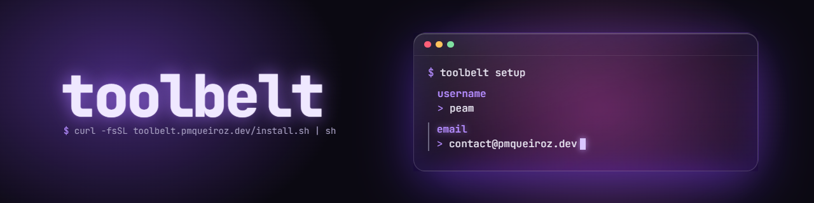

<!-- VARS -->
[peam-url]: https://pmqueiroz.dev/
[curl-url]: https://curl.se/
[brew-url]: https://brew.sh/
[winget-url]: https://learn.microsoft.com/windows/package-manager/winget/
[code-url]: https://code.visualstudio.com/
[go-url]: https://go.dev/
[releases-url]: https://github.com/pmqueiroz/toolbelt/releases
[bws-url]: https://bitwarden.com/products/secrets-manager/
<!-- END_VARS -->



### Requirements

`tb` is a single binary for Linux, macOS and Windows (amd64 and arm64). The installer only needs:
   * **Linux / macOS**: [Curl][curl-url] (or wget). [Homebrew][brew-url] is installed for you if missing
   * **Windows**: [winget][winget-url] (ships with Windows 10 1809+ and 11)
   * **Linux only**: [Visual Studio Code][code-url] installed with <kbd>code</kbd> in PATH, for the `code` recipe (macOS and Windows get it installed)

### Run

### Recommended

Install the latest release and start the setup

```sh
curl -fsSL https://toolbelt.pmqueiroz.dev/install.sh | sh
```

```powershell
irm https://toolbelt.pmqueiroz.dev/install.ps1 | iex
```

`tb setup` asks everything up front (identity, steps, recipes, tokens), shows the full plan and only changes something after you confirm it. Answer no to see the plan without touching the machine.

### More Unstable

Build from `master` with [Go][go-url], or grab an archive from the [releases][releases-url]

```sh
$ go install github.com/pmqueiroz/toolbelt/cmd/tb@master
$ tb setup
```

### Options

| option  |          description             |
|---------|----------------------------------|
| <kbd>tb setup --verbose</kbd> | show the output of every command instead of only logging it |
| <kbd>TOOLBELT_INSTALL_DIR</kbd> | where the installer puts `tb` (default `~/.local/bin`, `%LOCALAPPDATA%\Programs\toolbelt` on windows) |
| <kbd>TOOLBELT_SKIP_BREW</kbd> | don't install homebrew when it's missing |
| <kbd>TOOLBELT_SKIP_SETUP</kbd> | only install `tb`, don't run `tb setup` |

### Commands

| command  |          description             |
|---------|----------------------------------|
| <kbd>tb setup</kbd> | shell sources, recipes, dot files, ssh key, npm token and gpg signing key |
| <kbd>tb pr</kbd> | open the current branch's pr, or create one titled after the branch |
| <kbd>tb commit [msg]</kbd> | stage everything and commit, titled after the branch when no message is given |
| <kbd>tb checkout [branch\|pr]</kbd> | switch branch (default branch when empty), pull and prune the other local branches |
| <kbd>tb hot &lt;cmd&gt; &lt;files&gt;</kbd> | rerun a command every time one of the files changes |
| <kbd>tb benchmark [-d 5m]</kbd> | generate random uuids for 1m, 5m or a custom time and estimate the years to find them all and the time to fill ram and disk |
| <kbd>tb env [value]</kbd> | print a secret masked, or every env var masked when empty |
| <kbd>tb secret set KEY [VALUE]</kbd> | store a secret, value from stdin when omitted (`echo v \| tb secret set k`) |
| <kbd>tb secret get KEY</kbd> | print a secret, for piping (`export TOKEN=$(tb secret get TOKEN)`) |
| <kbd>tb secret list [--reveal]</kbd> | list secrets, masked unless `--reveal` |
| <kbd>tb secret connect</kbd> | link to a [Bitwarden Secrets Manager][bws-url] project (free plan works) and mirror it locally, encrypted |
| <kbd>tb update</kbd> | update `tb` to the latest release |

The shell sources alias `pr`, `commit`, `checkout` and `hot` to their `tb` command.

<div align="center">

<samp>Made with :heart: by [**Peam**][peam-url]</samp> 

</div>
